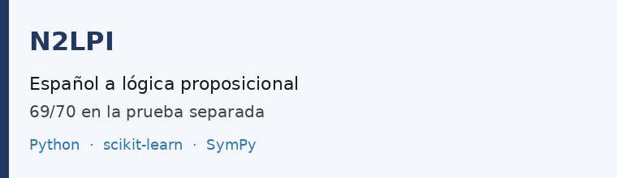
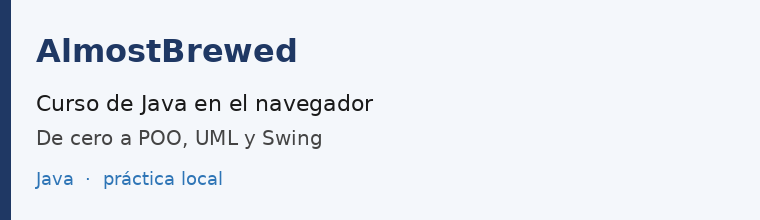
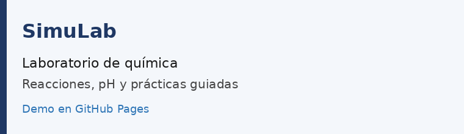
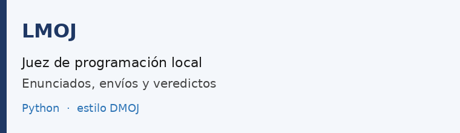

Estudiante de Ingeniería en Informáticas. Disponible para trabajo remoto y proyectos por encargo.

El [planificador de eventos](https://planificador-eventos-production-4dd0.up.railway.app/projects) es una colaboración.

## Proyectos

<table>
<tr>
<td width="50%">

</td>
<td width="50%">

</td>
</tr>
<tr>
<td width="50%">

</td>
<td width="50%">

</td>
</tr>
</table>

[DMOJ, unos 350 problemas resueltos](https://dmoj.uclv.edu.cu/user/Hd/solved) · [Telegram](https://t.me/Naharai_06) · derekhd05@gmail.com

También: [diagonalización de matrices](https://github.com/3DKNHD/Simple-Diagonalization-App) · [soluciones en DMOJ](https://github.com/3DKNHD/Dmoj-CU-Solutions)
