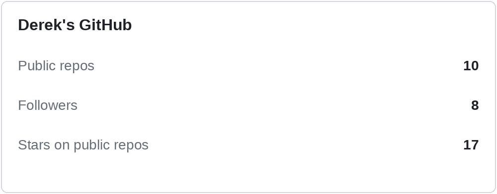
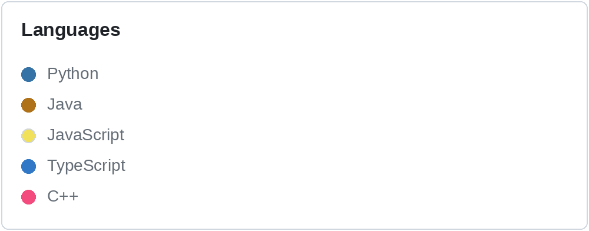
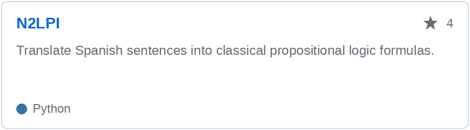
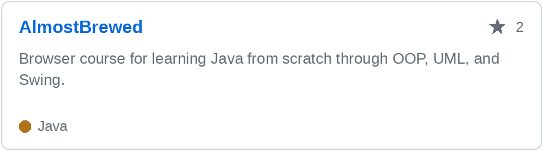
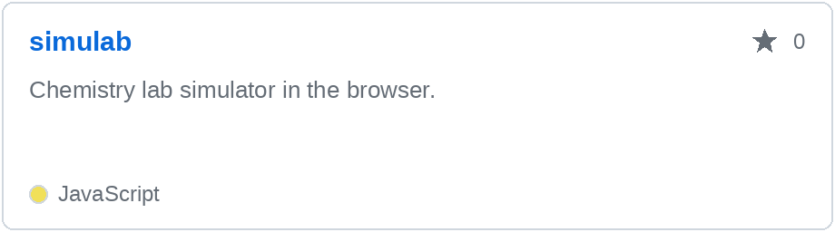
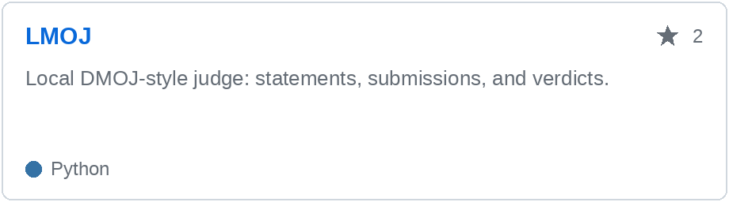

# Hi, I'm Derek

## GitHub

<table>
<tr>
<td width="50%">
<picture>
<source media="(prefers-color-scheme: dark)" srcset="stats-github-dark.png">

</picture>
</td>
<td width="50%">
<picture>
<source media="(prefers-color-scheme: dark)" srcset="stats-langs-dark.png">

</picture>
</td>
</tr>
</table>

## About

I'm an Informatics Engineering student, available for remote work and contract projects.

The [event planner](https://planificador-eventos-production-4dd0.up.railway.app/projects) is a collaboration: a Next.js app with a critical-path engine and a Gantt chart, live now.

## Projects

<table>
<tr>
<td width="50%">
<a href="https://github.com/3DKNHD/N2LPI-Natural-Language-to-Propositional-Logic-Interface"><picture>
<source media="(prefers-color-scheme: dark)" srcset="n2lpi-dark.png">

</picture></a>
</td>
<td width="50%">
<a href="https://github.com/3DKNHD/AlmostBrewed"><picture>
<source media="(prefers-color-scheme: dark)" srcset="almost-dark.png">

</picture></a>
</td>
</tr>
<tr>
<td width="50%">
<a href="https://github.com/3DKNHD/simulab"><picture>
<source media="(prefers-color-scheme: dark)" srcset="simulab-dark.png">

</picture></a>
</td>
<td width="50%">
<a href="https://github.com/3DKNHD/LMOJ"><picture>
<source media="(prefers-color-scheme: dark)" srcset="lmoj-dark.png">

</picture></a>
</td>
</tr>
</table>

## Also

[DMOJ, about 350 solved](https://dmoj.uclv.edu.cu/user/Hd/solved) · [DMOJ solutions](https://github.com/3DKNHD/Dmoj-CU-Solutions) · [matrix diagonalization](https://github.com/3DKNHD/Simple-Diagonalization-App)

[Telegram](https://t.me/Naharai_06) · [derekhd05@gmail.com](mailto:derekhd05@gmail.com)

También trabajo en español. Remoto y proyectos por encargo.
